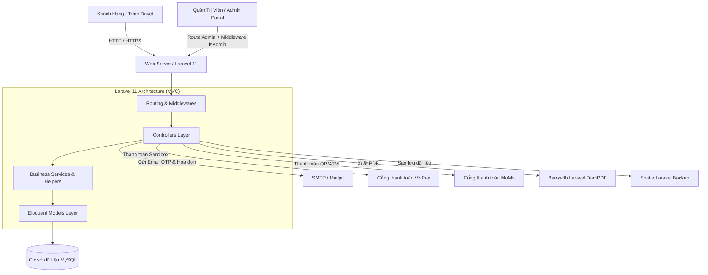
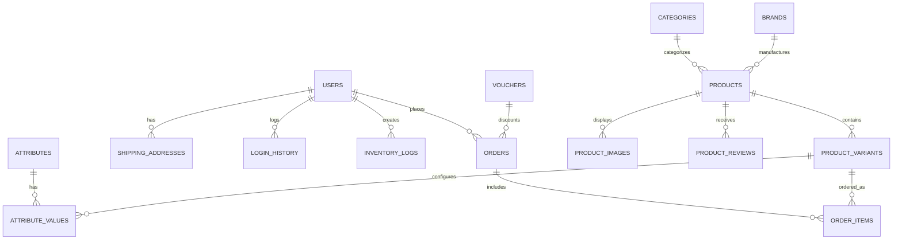

# ĐỒ ÁN MÔN HỌC: BACKEND 2 (BE2)
## HỆ THỐNG THƯƠNG MẠI ĐIỆN TỬ BÁN LẺ THIẾT BỊ CÔNG NGHỆ THÔNG MINH

> **Dự án:** DOAN_BE2_NhomI  
> **Ngôn ngữ & Framework:** PHP 8.2+ | Laravel 11.x | MySQL | TailwindCSS | Vite  
> **Repository:** [ngnhanbao/DOAN_BE2_NhomI](https://github.com/ngnhanbao/DOAN_BE2_NhomI)

---

## 📑 MỤC LỤC
1. [Giới Thiệu Dự Án](#1-giới-thiệu-dự-án)
2. [Thông Tin Nhóm Thực Hiện & Phân Công Nhiệm Vụ](#2-thông-tin-nhóm-thực-hiện--phân-công-nhiệm-vụ)
3. [Kiến Trúc Kỹ Thuật & Công Nghệ Sử Dụng](#3-kiến-trúc-kỹ-thuật--công-nghệ-sử-dụng)
4. [Sơ Đồ & Thiết Kế Cơ Sở Dữ Liệu](#4-sơ-đồ--thiết-kế-cơ-sở-dữ-liệu)
5. [Danh Mục Chức Năng Chi Tiết](#5-danh-mục-chức-năng-chi-tiết)
   - [Phân hệ Khách hàng (Client / Frontend)](#51-phân-hệ-khách-hàng-client--frontend)
   - [Phân hệ Quản trị (Admin / Backoffice)](#52-phân-hệ-quản-trị-admin--backoffice)
6. [Hướng Dẫn Cài Đặt & Triển Khai (Setup & Run)](#6-hướng-dẫn-cài-đặt--triển-khai-setup--run)
7. [Cấu Hình Môi Trường (.env) & Tài Khoản Thử Nghiệm](#7-cấu-hình-môi-trường-env--tài-khoản-thử-nghiệm)
8. [Kiểm Thử & Đảm Bảo Chất Lượng (Testing)](#8-kiểm-thử--đảm-bảo-chất-lượng-testing)

---

## 1. GIỚI THIỆU DỰ ÁN

**DOAN_BE2_NhomI** là giải pháp website thương mại điện tử chuyên biệt phục vụ phân phối thiết bị công nghệ hiện đại (Điện thoại thông minh, Laptop, Tai nghe, Phụ kiện cao cấp). Dự án được thiết kế chuẩn mô hình MVC trên nền tảng **Laravel 11**, chú trọng vào khả năng xử lý nghiệp vụ Backend phức tạp:
- Quản lý sản phẩm đa biến thể (Màu sắc, Dung lượng, Bộ nhớ RAM/ROM).
- Tích hợp cổng thanh toán trực tuyến (**VNPay Sandbox**, **MoMo QR/ATM**, **COD**).
- Quản lý kho hàng nhập/xuất tự động (**Inventory Logs**).
- Tính toán chi phí vận chuyển động theo khu vực/tỉnh thành.
- Cơ chế giỏ hàng linh hoạt (lưu trữ session cho khách vãng lai và tự động đồng bộ khi đăng nhập).
- Bảo mật xác thực: Đăng ký xác minh mã OTP qua Email, lưu vết lịch sử đăng nhập, xác thực 2 bước (2FA), cơ chế chống Race Condition / Concurrency.
- Tiện ích hỗ trợ người dùng: So sánh thông số sản phẩm trực tiếp, xuất hóa đơn điện tử chuẩn **PDF** (`barryvdh/laravel-dompdf`), sao lưu & phục hồi dữ liệu hệ thống (`spatie/laravel-backup`).

---

## 2. THÔNG TIN NHÓM THỰC HIỆN & PHÂN CÔNG NHIỆM VỤ

| STT | Thành Viên | Vai Trò | Các Module & Chức Năng Đảm Nhiệm Chính |
|:---:|:---|:---:|:---|
| **1** | **Nguyễn Nhân Bảo** *(Nhóm trưởng)* | Backend & Core | • Cơ chế giỏ hàng thông minh (Session & Database syncing)<br>• Quản lý thuộc tính sản phẩm động (Attributes & Attribute Values)<br>• Xuất hóa đơn bán hàng định dạng PDF (`barryvdh/laravel-dompdf`)<br>• Quản lý kho hàng & lịch sử biến động kho (`Inventory Logs`)<br>• Chức năng so sánh thông số sản phẩm (Product Comparison)<br>• Quên mật khẩu & cấp lại mật khẩu an toàn qua Email |
| **2** | **Nguyễn Xuân Thu Trang** | Backend / Payment | • Xác thực người dùng (Đăng nhập, Đăng xuất, Lưu vết `login_history`)<br>• Quản lý thông tin hồ sơ & sổ địa chỉ nhận hàng cá nhân<br>• Lịch sử đơn hàng và chi tiết trạng thái đơn<br>• Phân hệ tính toán phí vận chuyển tự động (Shipping Fees)<br>• Tích hợp cổng thanh toán điện tử **MoMo** và **VNPay**<br>• Báo cáo & thống kê doanh thu |
| **3** | **Nguyễn Văn Thực** | Backend / Catalog & Auth | • Quản lý sản phẩm nâng cao (CRUD Products, biến thể Variants, ảnh con)<br>• Quản lý danh mục thương hiệu (Brands)<br>• Xử lý hủy đơn hàng & luồng hoàn tiền<br>• Đổi mật khẩu cá nhân & phân quyền Admin/Staff (`IsAdmin` middleware)<br>• Dashboard tổng quan thống kê kinh doanh<br>• Quản lý Voucher khuyến mãi & API đồng bộ giá thời gian thực (`price-realtime`) |
| **4** | **Đức Trung** | Backend & Security | • Luồng tạo đơn hàng từ giỏ hàng (Checkout flow toàn diện)<br>• Đăng ký tài khoản xác thực mã OTP gửi qua Email<br>• Quản lý & duyệt đánh giá sản phẩm (Product Reviews & Ratings)<br>• Phân hệ Backup & Restore cơ sở dữ liệu (`spatie/laravel-backup`)<br>• Quản lý danh mục hàng hóa (Categories)<br>• Thống kê sản phẩm xu hướng / thịnh hành (Trending Products) |

---

## 3. KIẾN TRÚC KỸ THUẬT & CÔNG NGHỆ SỬ DỤNG



- **Hệ điều hành / Môi trường:** Windows / Linux / macOS (Tương thích Laragon, XAMPP, Docker Sail).
- **Backend Framework:** Laravel 11.31+, PHP >= 8.2.
- **ORM:** Laravel Eloquent ORM.
- **Database Engine:** MySQL 8.x / MariaDB với Engine InnoDB hỗ trợ ACID & Khóa ngoại (Foreign Key Constraints).
- **Frontend Assets:** Blade Templates, TailwindCSS, Vite bundler, JavaScript (Fetch API / AJAX).

---

## 4. SƠ ĐỒ & THIẾT KẾ CƠ SỞ DỮ LIỆU

Hệ thống sở hữu cấu trúc dữ liệu chuẩn hóa 3NF, phục vụ các luồng nghiệp vụ E-commerce:



### Các bảng dữ liệu trọng tâm:
1. `users`: Tài khoản khách hàng, nhân viên, quản trị viên; hỗ trợ 2FA, mã hash Bcrypt.
2. `login_history`: Nhật ký thời gian, địa chỉ IP, User-Agent khi đăng nhập.
3. `categories` & `brands`: Phân loại nhóm hàng và thương hiệu phân phối.
4. `products`: Bảng thông tin sản phẩm gốc (tên, slug, mô tả, thông số kỹ thuật JSON `specs`, trạng thái hot/new/trending).
5. `product_variants`: Biến thể cụ thể theo thuộc tính (SKU, giá bán lẻ, giá khuyến mãi, số lượng tồn kho).
6. `attributes` & `attribute_values`: Bảng thuộc tính linh hoạt (RAM, Bộ nhớ trong, Màu sắc).
7. `orders` & `order_items`: Lưu thông tin giao dịch, tổng tiền, phương thức thanh toán, mã vận đơn, trạng thái thanh toán và vận chuyển.
8. `shipping_addresses` & `shipping_fees`: Sổ địa chỉ giao hàng và bảng định mức cước phí vận chuyển theo khu vực.
9. `vouchers`: Bảng mã giảm giá (loại giảm theo %, tiền mặt, điều kiện đơn tối thiểu, số lượt dùng).
10. `inventory_logs`: Nhật ký kiểm kê kho hàng, theo dõi chi tiết số lượng nhập xuất và nhân viên thao tác.

---

## 5. DANH MỤC CHỨC NĂNG CHI TIẾT

### 5.1. Phân hệ Khách hàng (Client / Frontend)
- **Trang chủ & Khám phá sản phẩm:**
  - Banner quảng bá, danh mục sản phẩm nổi bật, sản phẩm mới về (`is_new`), sản phẩm xu hướng (`is_trending`).
  - Thanh tìm kiếm AJAX tức thì (Instant Search) lọc theo tên và danh mục.
- **Chi tiết sản phẩm & Biến thể:**
  - Xem thông số kỹ thuật, bộ sưu tập ảnh trượt (Gallery).
  - Chọn lựa biến thể trực tiếp (Màu sắc, Dung lượng) -> Giá và số lượng tự động cập nhật theo thời gian thực.
  - Xem và gửi đánh giá / bình luận kèm số sao rating.
- **So sánh sản phẩm (Compare):**
  - Đưa 2 hoặc nhiều thiết bị vào danh sách so sánh để đối chiếu trực quan thông số phần cứng, giá bán.
- **Giỏ hàng & Khuyến mãi:**
  - Thêm, sửa số lượng, xóa sản phẩm khỏi giỏ hàng.
  - Lưu trạng thái giỏ hàng khi chưa đăng nhập và đồng bộ sau khi đăng nhập.
  - Nhập mã Voucher giảm giá, hệ thống kiểm tra tính hợp lệ và tự động trừ tiền.
- **Thanh toán & Đơn hàng:**
  - Tự động lấy địa chỉ mặc định hoặc thêm địa chỉ mới; tính phí ship động.
  - Lựa chọn phương thức thanh toán: COD, VNPay Sandbox, MoMo Sandbox.
  - Theo dõi tiến trình đơn hàng (Chờ xác nhận -> Đang xử lý -> Đang giao -> Đã nhận).
  - Xuất hóa đơn bán lẻ PDF chuyên nghiệp và nhận email thông báo.

### 5.2. Phân hệ Quản trị (Admin / Backoffice)
- **Bảng điều khiển (Dashboard):** Thống kê doanh thu, số lượng đơn hàng, biểu đồ tăng trưởng, cảnh báo sản phẩm sắp hết hàng trong kho.
- **Quản lý danh mục & Thương hiệu:** Thêm, sửa, xóa danh mục có hỗ trợ cấp cha/con (`parent_id`, `sort_order`) và thương hiệu.
- **Quản lý sản phẩm & Biến thể:** Quản lý kho SKU, giá gốc, giá biến thể, thư viện ảnh đa phương tiện, thuộc tính động.
- **Quản lý nhập kho (Inventory Logs):** Ghi nhận phiếu nhập kho, tăng số lượng tồn, lưu vết người tạo phiếu.
- **Quản lý đơn hàng:** Tiếp nhận đơn, cập nhật trạng thái đơn hàng, hủy đơn và xử lý hoàn tiền nếu khách yêu cầu.
- **Quản lý Voucher:** Thiết lập mã giảm giá, giới hạn ngân sách, hạn dùng `start_at` và `end_at`.
- **Quản lý tài khoản & Phân quyền:** Phân loại Admin / Staff / User; kiểm tra nhật ký đăng nhập để kịp thời phát hiện truy cập bất thường.
- **Sao lưu hệ thống (Backup & Restore):** Hỗ trợ tạo bản sao lưu Database và tải về lưu trữ định kỳ.

---

## 6. HƯỚNG DẪN CÀI ĐẶT & TRIỂN KHAI (SETUP & RUN)

### Yêu cầu hệ thống:
- **PHP:** >= 8.2 (Bật các extension: `pdo_mysql`, `mbstring`, `openssl`, `gd`, `fileinfo`, `curl`)
- **Composer:** >= 2.x
- **Node.js:** >= 18.x & **NPM:** >= 9.x
- **Cơ sở dữ liệu:** MySQL 8.0+ hoặc MariaDB 10.4+

### Các bước cài đặt chi tiết:

#### Bước 1: Sao chép mã nguồn về máy
```bash
git clone https://github.com/ngnhanbao/DOAN_BE2_NhomI.git
cd DOAN_BE2_NhomI
```

*(Lưu ý: Nếu làm việc trên thư mục dự án Laravel `DoAn-BE2-NhomI`, hãy điều hướng vào đúng thư mục con chứa mã nguồn)*
```bash
cd DoAn-BE2-NhomI
```

#### Bước 2: Cài đặt các gói phụ thuộc (Dependencies)
```bash
# Cài đặt thư viện PHP Backend
composer install

# Cài đặt các gói giao diện Frontend
npm install
```

#### Bước 3: Thiết lập tệp cấu hình môi trường (.env)
```bash
# Sao chép tệp .env mẫu
cp .env.example .env

# Khởi tạo Application Encryption Key
php artisan key:generate
```

#### Bước 4: Tạo cơ sở dữ liệu và cấu hình kết nối
Mở tệp `.env` và cập nhật thông số kết nối Database:
```env
DB_CONNECTION=mysql
DB_HOST=127.0.0.1
DB_PORT=3306
DB_DATABASE=nhomi_project_db
DB_USERNAME=root
DB_PASSWORD=
```
Tạo Database có tên `nhomi_project_db` trong phpMyAdmin hoặc MySQL Workbench.

#### Bước 5: Chạy Migration và Seed dữ liệu mẫu
```bash
php artisan migrate:fresh --seed
```
*Lệnh trên sẽ tự động thiết lập toàn bộ bảng dữ liệu, tạo sẵn dữ liệu mẫu về danh mục, sản phẩm, biến thể, voucher, đơn hàng và các tài khoản thử nghiệm.*

#### Bước 6: Tạo liên kết thư mục lưu trữ ảnh (Storage Link)
```bash
php artisan storage:link
```

#### Bước 7: Khởi chạy dự án
Chạy đồng thời Web Server và Vite build:
```bash
# Cửa sổ dòng lệnh 1: Chạy Server Laravel
php artisan serve

# Cửa sổ dòng lệnh 2: Chạy Vite Asset Watcher
npm run dev
```
Truy cập trình duyệt tại địa chỉ: **`http://127.0.0.1:8000`**

---

## 7. CẤU HÌNH MÔI TRƯỜNG (.ENV) & TÀI KHOẢN THỬ NGHIỆM

### 7.1. Danh sách tài khoản thử nghiệm (Default Accounts)

Mật khẩu chung cho tất cả tài khoản mẫu: **`12345678`**

| Vai Trò (Role) | Email Đăng Nhập | Mật Khẩu | Quyền Hạn |
|:---|:---|:---:|:---|
| **Administrator** | `admin@gmail.com` | `12345678` | Toàn quyền quản trị hệ thống, truy cập trang `/admin` |
| **Nhân viên (Staff)** | `staff@gmail.com` | `12345678` | Quản lý kho, xử lý đơn hàng, quản lý danh mục |
| **Khách hàng mẫu** | `user@gmail.com` | `12345678` | Trải nghiệm mua sắm, đặt hàng, quản lý địa chỉ |
| **User thử nghiệm** | `user1@gmail.com` -> `user20@gmail.com` | `12345678` | Dữ liệu mẫu dùng cho phân tích, thống kê |

### 7.2. Cấu hình Mail gửi OTP & Hóa đơn (Mailpit / Mailtrap)
Để kiểm tra tính năng gửi OTP kích hoạt tài khoản và gửi hóa đơn đặt hàng:
```env
MAIL_MAILER=smtp
MAIL_HOST=127.0.0.1
MAIL_PORT=1025
MAIL_USERNAME=null
MAIL_PASSWORD=null
MAIL_ENCRYPTION=null
MAIL_FROM_ADDRESS="no-reply@nhomi.com"
MAIL_FROM_NAME="DOAN_BE2_NhomI"
```

### 7.3. Cấu hình Cổng thanh toán Sandbox (MoMo / VNPay)
Dự án đã tích hợp sẵn cơ chế Mock Portal và cấu hình Sandbox cho VNPay và MoMo giúp việc nghiệm thu đồ án diễn ra trơn tru mà không bị phụ thuộc tài khoản ngân hàng thật.

---

## 8. KIỂM THỬ & ĐẢM BẢO CHẤT LƯỢNG (TESTING)

Dự án được viết sẵn các bộ kiểm thử tự động (Feature Tests) sử dụng **PHPUnit** nhằm xác nhận tính an toàn khi thực thi đồng thời (Concurrency Handling):
- `ProductConcurrencyTest`: Kiểm tra đặt hàng sản phẩm đồng thời, ngăn chặn việc tồn kho bị âm khi nhiều người mua cùng lúc.
- `BrandConcurrencyTest`: Kiểm tra tính toàn vẹn dữ liệu danh mục thương hiệu khi cập nhật liên tục.
- `PermissionConcurrencyTest`: Kiểm tra tính chặt chẽ trong phân quyền tài khoản.

Chạy kiểm thử:
```bash
php artisan test
```

---
*Đồ án học tập thuộc khuôn khổ môn học Backend 2 - Nhóm I trân trọng cảm ơn Thầy/Cô đã theo dõi và đánh giá!*